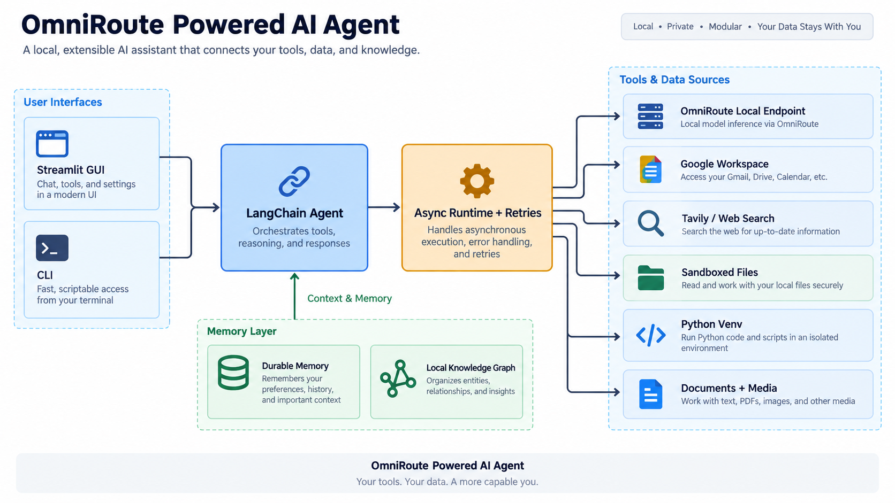

# OmniRoute Powered AI Agent

This project is a powerful, interactive AI agent that runs its main chat model through a local OmniRoute OpenAI-compatible endpoint. OmniRoute can route and fail over across providers behind one local API, giving the agent longer, more flexible AI usage without hardcoding a single hosted provider. The agent can be controlled through a command-line interface (CLI) or a Streamlit-based graphical user interface (GUI).



## Key Features

- **OmniRoute LLM Routing:** Powered by `ChatOpenAI` against OmniRoute's local endpoint, defaulting to `http://localhost:20128/v1` and model `auto`.
- **Asynchronous Agent Runtime:** Uses LangChain `ainvoke`, async tools, background Streamlit jobs, bounded retries, and friendly error reporting so slow Google, research, and media calls do not freeze the assistant.
- **Full-Time PC Assistant Mode:** Includes a Streamlit assistant console, one-click daily brief actions, local task tracking, durable memory, and local graph memory.
- **D-Drive First Runtime Storage:** Memory, task data, Google tokens, caches, and the recommended virtual environment can live under `D:\AI` to keep the Windows system drive light.
- **Project Sandbox For Outputs:** Generated files are constrained to `./agent_working` inside the AI-AGENT project folder.
- **Extensive Toolset:** The agent is equipped with a rich set of tools, enabling it to interact with various services and perform complex actions:
    - **Google Workspace:** Seamlessly integrates with Gmail, Google Calendar, and Google Drive to manage your digital life.
    - **Web Search:** Utilizes Tavily to find up-to-date information on the web when `TAVILY_API_KEY` is configured.
    - **Topic Research:** Creates cited research briefs, saves source metadata, and stores research artifacts under the assistant workspace.
    - **OmniRoute Media Generation:** Lists local Omniroute image/video routes and can generate media into the project sandbox. Gemini image generation remains an optional fallback when `GEMINI_API_KEY` is configured.
    - **Document Creation:** Can create professional-looking PowerPoint presentations and Word documents with both text and images.
    - **Managed Code Execution:** Runs Python scripts from the project sandbox and can install pip packages into the dedicated virtual environment when needed.
    - **File Management:** Can read and write files within a sandboxed assistant workspace.
- **Conversational Memory:** Maintains a summary of the conversation, allowing it to retain context over longer interactions.
- **Durable Personal Memory:** Stores user preferences, project notes, and local tasks across sessions in JSON files under the assistant home directory.
- **Local Knowledge Graph Memory:** Stores compact entities and relationships in `knowledge_graph.json` under the assistant home directory. OmniRoute is used as a local extraction pipeline after each turn, while the graph itself stays fully local and free.
- **Cost Tracking:** Monitors token usage and can estimate cost when OmniRoute pricing env vars are provided.
- **Secure and Sandboxed:** File tools, generated documents, generated media, and managed Python scripts are restricted to the `agent_working` directory to reduce accidental local file damage. Disk cleanup, disk analysis, and storage-management tasks are intentionally outside the assistant's scope.

## Project Architecture

The agent's architecture is designed to be modular and extensible. Here's a breakdown of the key components:

- **`main.py`:** This is the heart of the application, containing the main chat loop, agent initialization, and tool configuration.
- **`llm_config.py`:** Centralizes OmniRoute endpoint, model, timeout, temperature, API key, and optional pricing configuration.
- **`assistant_state.py`:** Manages durable profile, memory, task, note, and workspace paths, defaulting to `D:\AI\assistant` on Windows.
- **`graph_memory.py`:** Maintains the local JSON knowledge graph, relevant-context lookup, and OmniRoute-powered graph extraction pipeline.
- **`personal_tools.py`:** Adds everyday assistant tools for memory, graph facts, profile updates, task tracking, and daily brief generation.
- **`research_tools.py`:** Adds async topic research with Tavily support and a lightweight search fallback, source fetching, citation prompts, and saved Markdown briefs.
- **`media_tools.py`:** Adds async Omniroute media-model discovery plus image and video generation helpers with retries and sandboxed file output.
- **`code_tools.py`:** Adds managed Python script execution and venv-only pip installation for coding tasks.
- **`async_utils.py`:** Centralizes background execution, retry/backoff behavior, and friendly exception formatting.
- **`file_tools.py`:** Provides sandboxed read/write tools for the shared `agent_working` directory.
- **`gui.py`:** This file provides a user-friendly graphical interface using Streamlit, making it easy to interact with the agent in a more visual way.
- **`run_assistant.ps1`:** Starts the Streamlit PC assistant using a D-drive virtual environment.
- **`install_windows_startup.ps1`:** Creates a Windows Startup shortcut so the assistant launches after login.
- **Tool Modules (`*_tools.py`):** Each module defines a specific set of tools that the agent can use. This modular approach makes it easy to add new capabilities to the agent.
- **`get_google_service.py`:** This module handles the authentication and authorization for all Google Workspace services.
- **Pydantic Models:** The tools use Pydantic models to define their input schemas, which ensures that the LLM provides the correct arguments and reduces errors.

## Getting Started

### Prerequisites

- Python 3.11 or higher
- OmniRoute running locally. By default, the app expects:
    - Base URL: `http://localhost:20128/v1`
    - Model: `auto`
    - API key: an endpoint key copied from the OmniRoute dashboard, if your local endpoint requires one
- An active Google Cloud project with the following APIs enabled:
    - Gmail API
    - Google Calendar API
    - Google Drive API
- A `credentials.json` file from your Google Cloud project.

### Installation

1. **Clone the repository:**
   ```bash
   git clone https://github.com/your-username/ai-agent.git
   cd ai-agent
   ```

2. **Install the required packages:**
   This project uses `uv` for fast and efficient package management.
   ```bash
   pip install uv
   uv sync
   ```
   Alternatively, you can use `pip`:
   ```bash
   pip install -r requirements.txt
   ```

3. **Set up your API keys:**
   Create a `.env` file in the root of the project and add your API keys:
   ```
   OMNIROUTE_API_KEY="your-omniroute-endpoint-key"
   OMNIROUTE_BASE_URL="http://localhost:20128/v1"
   OMNIROUTE_MODEL="auto"
   AI_AGENT_HOME="D:/AI/assistant"
   AI_AGENT_WORKSPACE="./agent_working"
   AI_AGENT_VENV="D:/AI/venvs/ai-agent"
   TAVILY_API_KEY="your-tavily-api-key"
   ```
   You can copy `.env.example` as a starting point. `TAVILY_API_KEY` is optional; without it, topic research uses a lightweight web-search fallback. `GEMINI_API_KEY` is optional and only needed for the legacy Gemini image fallback.

4. **Authorize Google Workspace access:**
   - Place your `credentials.json` file in the root of the project.
   - Run the `get_google_service.py` script to authorize the application. This will open a browser window for you to log in and grant permission. Upon successful authorization, a `token.pickle` file will be created to store your access tokens.
   ```bash
   python get_google_service.py
   ```
   Both `credentials.json` and `token.pickle` are gitignored and should stay out of source control.

   On Windows, you can also run the guided helper:
   ```powershell
   powershell -ExecutionPolicy Bypass -File .\finish_google_oauth_setup.ps1
   ```
   It opens the needed Google Cloud pages in Brave/default browser, watches Downloads for the OAuth client JSON, copies it to `credentials.json`, and runs the local authorization flow.

### Usage

You can interact with the agent through the command line or a graphical user interface.

**Command-Line Interface (CLI):**
```bash
python main.py
```

**Graphical User Interface (GUI):**
```bash
streamlit run gui.py
```
The Streamlit app runs long assistant turns in a background worker and refreshes while they complete, so slow research, Google, image, or video operations do not lock the page.

**Windows PC Assistant Launcher:**
```powershell
powershell -ExecutionPolicy Bypass -File .\run_assistant.ps1
```

This uses `D:\AI\venvs\ai-agent` for Python packages and `D:\AI\assistant` for assistant data by default.

## Local Memory And Context

The assistant keeps three local memory layers:

- Recent chat summary for short-term continuity.
- Durable JSONL memories and tasks for explicit notes, preferences, and plans.
- A local knowledge graph for compact relationships such as projects, preferred tools, recurring goals, avoided actions, services used, and decisions.

Before each request, the runtime queries the local graph and prepends only the most relevant compact context. After each response, OmniRoute extracts small graph updates from the exchange and stores them locally. If extraction fails, the assistant keeps working and falls back to simple local extraction. This is designed to improve context awareness and reduce repeated token-heavy reminders without needing a hosted graph database.

**Launch On Windows Login:**
```powershell
powershell -ExecutionPolicy Bypass -File .\install_windows_startup.ps1
```

This creates a Startup folder shortcut that runs `run_assistant.ps1` after you sign in.

## Search And Media Notes

### Web Search

The assistant prefers Tavily when `TAVILY_API_KEY` is configured because Tavily returns structured, agent-friendly results. Without Tavily, `research_topic` falls back to lightweight public search-result parsing so quick research can still work without a paid/keyed API. The fallback is useful for casual lookups, but it can be less relevant, slower, easier to rate-limit, and more likely to break if search-result HTML changes.

### Free OmniRoute Media Routes

Run this prompt in the assistant to see the local routes currently exposed by OmniRoute:

```text
List Omniroute image and video generation models.
```

On the tested machine, OmniRoute exposed free/community media routes from AI Horde and `veoaifree-web`: image routes through `aihorde/*` and video routes such as `veo-free/veo` and `veo-free/seedance`. These routes should be treated as best-effort rather than unlimited. Free/community providers may queue requests, time out, rate-limit, change availability, or return no media. The app handles this with async background jobs, retries, long timeouts, and clear failure messages so the UI does not freeze. Generated media is saved under `./agent_working/media`.

## Tool-Specific Examples

Here are some examples of how you can use the agent's tools:

- **Create a presentation:**
  `"Create a 5-slide presentation on the history of space exploration, with images."`
- **Create a Word document:**
  `"Create a Word document summarizing the key points of the latest AI trends, and include images."`
- **Send an email with an attachment:**
  `"Send an email to my manager with the presentation I just created."`
- **Schedule a meeting with a Google Meet link:**
  `"Schedule a meeting with the team for tomorrow at 10 AM to review the presentation. Include a Google Meet link."`
- **Search the web and save the results to a file:**
  `"What are the latest trends in artificial intelligence? Save the results to a file called 'ai_trends.txt'."`
- **Research a topic:**
  `"Research whether local AI assistants are useful for students. Create a standard brief with sources."`
- **List media models:**
  `"List Omniroute image and video generation models."`
- **Generate media through Omniroute:**
  `"Generate an image of a clean desktop productivity dashboard using a free Omniroute image route."`
- **Save durable context:**
  `"Remember that I prefer concise daily planning and that my AI project workspace is on D drive."`
- **Save graph context:**
  `"Remember as graph memory that AI-AGENT uses OmniRoute for long-running local assistant tasks."`
- **Track a task:**
  `"Add a high-priority task to review the AI-AGENT Omniroute migration tomorrow."`
- **Get a daily brief:**
  `"Give me my daily brief with tasks, calendar, and email."`

## Tested Local Capabilities And Prompts

These prompts and capabilities were manually tested on Windows using the dedicated D-drive virtual environment at `D:\AI\venvs\ai-agent`. Generated files stayed inside `F:\AI-AGENT\agent_working`.

| Capability | Working prompt | Verified result |
| --- | --- | --- |
| Word document generation | `Create a short Word document named capability_test.docx titled Local Assistant Capability Test with two concise paragraphs about sandboxed document creation and graph memory. Do not include images.` | Created `agent_working/capability_test.docx`. |
| PowerPoint generation | `Create a 3-slide PowerPoint named capability_test.pptx about AI-AGENT everyday assistant capabilities. Include slides for Memory, Research, and Document Creation. Do not include images.` | Created `agent_working/capability_test.pptx`. |
| Sandboxed file creation | `Use Python to create a CSV named capability_metrics.csv with columns capability,status and rows graph memory,working; docx generation,working; pptx generation,working.` | Created and read back `agent_working/capability_metrics.csv`. |
| Graph memory recall | `Recall graph context for AI-AGENT memory and sandboxed document creation. Answer in two concise bullets.` | Returned relevant graph context from `D:\AI\assistant\knowledge_graph.json`. |
| Explicit graph memory | `Remember as graph memory that AI-AGENT should prioritize sandboxed document creation for everyday users.` | Stored a local graph relationship for future context. |

Good everyday prompts to try:

- `Give me my daily brief with tasks, calendar, and recent important email.`
- `Research whether local AI assistants are useful for students. Create a standard brief with sources.`
- `Create a PowerPoint deck from this outline and save it in the workspace.`
- `Create a Word document with a polished summary and save it as a .docx file.`
- `Use Python in the sandbox to analyze this CSV and create a chart.`
- `Remember this project preference as graph memory: keep generated files inside the AI-AGENT sandbox.`
- `Recall relevant graph context before planning my next AI-AGENT improvement.`

## How to Contribute

We welcome contributions from the community! If you'd like to contribute to the project, please follow these steps:

1. **Fork the repository.**
2. **Create a new branch for your feature or bug fix.**
3. **Make your changes and commit them with clear, descriptive messages.**
4. **Push your changes to your fork.**
5. **Create a pull request to the main repository.**

We look forward to seeing your contributions!
